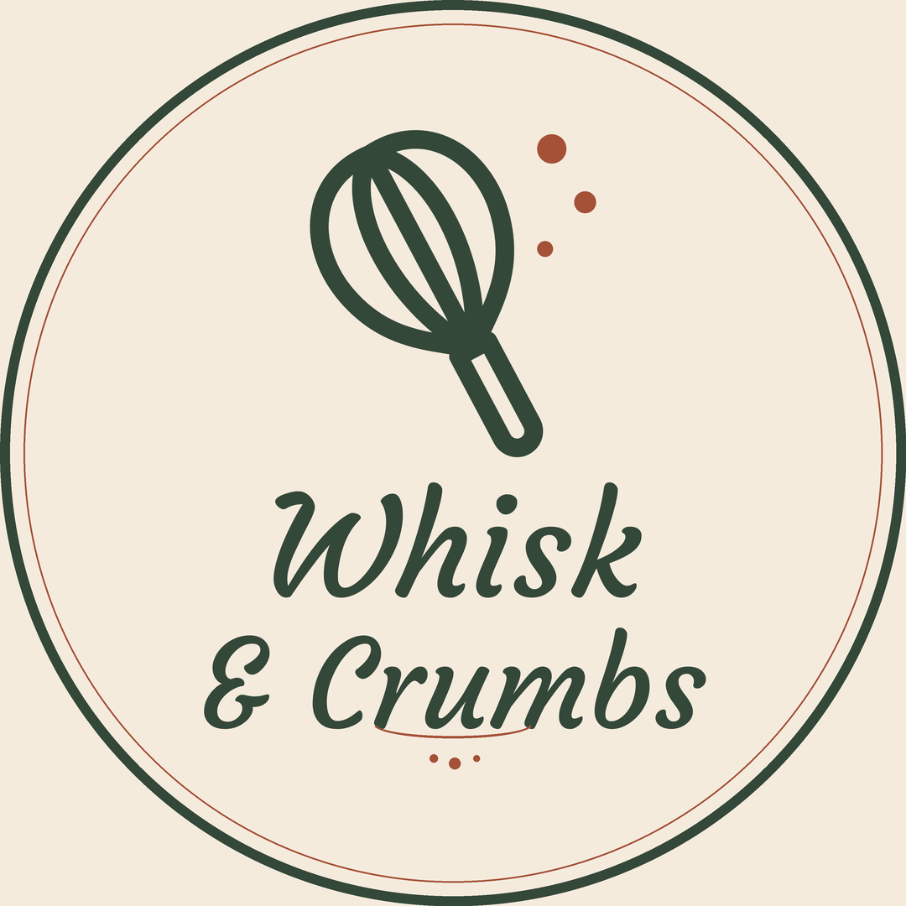
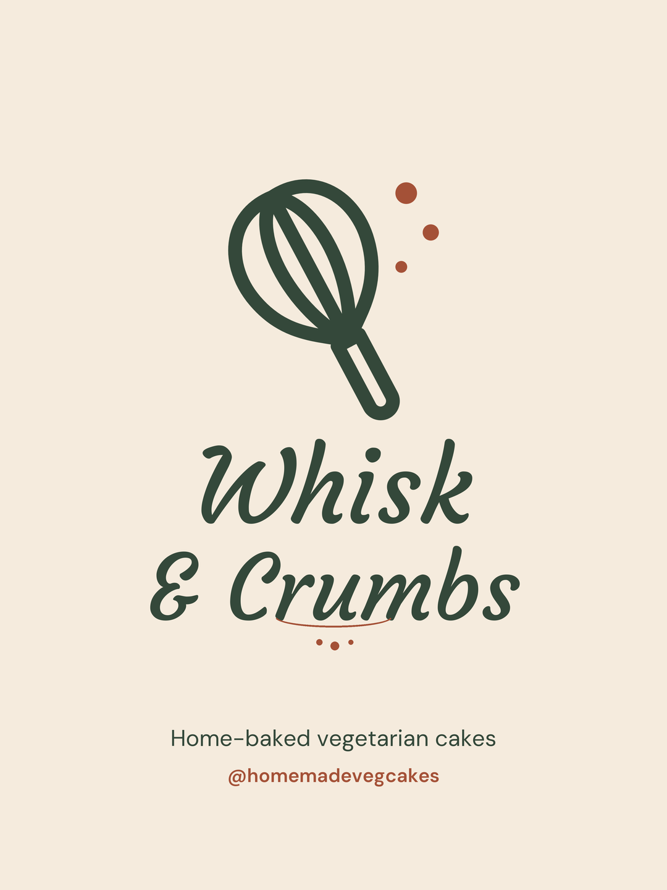
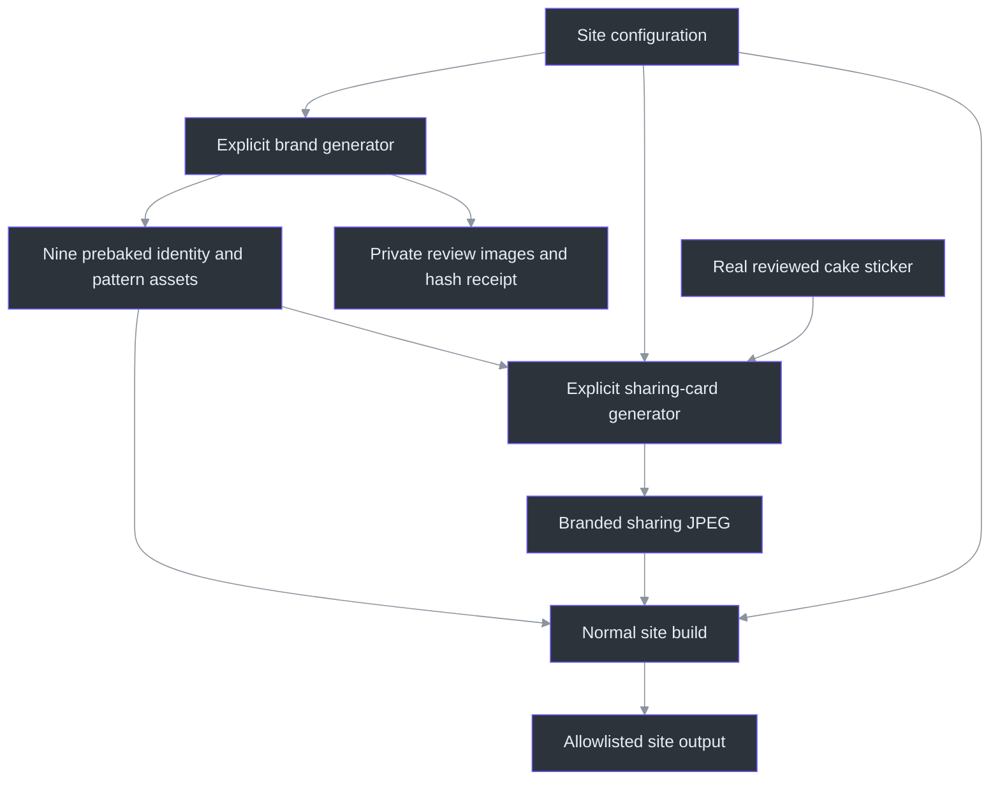
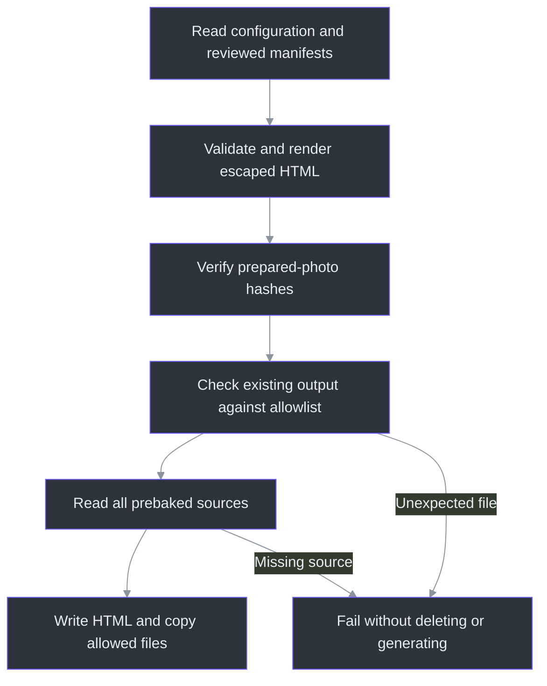

# Whisk & Crumbs: identity and quiet bakery backgrounds

## Overview

The user chose **Whisk & Crumbs**, with descriptor **Home-baked vegetarian cakes**.
The later spelling correction makes **Whisk** singular everywhere in maintained
branding and artwork. It does not rename the repository; the owner will do that
later. Current artwork review and its hash receipt are in `.local\singular-brand\`.
The generated website now contains160allowlisted files, including six refreshed README showcase JPGs and original storefrontSVGs,
and fifteen photograph records. All six covers use real cutouts, and open
notebooks retain four photos without vertical scrolling. The original website
palette, singular identity and mixing-bowl/whisk correction remain; covers alone
now use the explicitly requested light-pink shade. The user rejected blue and honey.
See
[the publishing guide](github-pages-publishing.md) for the deployed commit and
live-byte receipt. The earlier 125-file and `be221e6`/124-file releases are history.

## Category-notebook revision

The category request is implemented and its current UI is published under
workstream 16. The three previously missing covers now have selected derivatives.
P038/P145 and the wider archive review remain separate. Six top-bound covers sit
under Cakes we've made, with one plain cake-weight line before them. Every notebook
opens directly to photos; no weight pages remain. Zoom, buttons, arrow keys and upward dragging
retain the existing cream/green/terracotta palette, Courgette and DM Sans.

The later construction correction removes the wide coloured left strip, rounded
card-like outline and large fake folded cover corner. Category covers now have
very light-pink `#f7dbe4` faces, 2px corners, fine alternating cream paper edges and a thin green
backing. Inner pages retain light ruling away from text. Two shaded wire loops
enter each rectangular top-edge slot; spaced full tiles avoid clipped end coils.
Cover titles and photo counts use deep green on the pink face, without cream
backplates. Text contrast is7.59:1; cover/canvas separation is1.10:1, with a
contrasting green backing board. The body, hero, shared weight text and opened pages remain cream.
The subsequent hero request removes its earlier paper treatment entirely. The
intro is full-width on its original cream background, with deep-green copy,
terracotta emphasis and the existing sticker/actions. The user rejected the
unintended green hero colour; the story stays green. The hero has no spiral,
paper frame, fold or pointer tilt; only the category section uses notebooks.

The user supplied an annotated screenshot and five construction references.
Byte-identical private copies, filenames, hashes and dimensions are recorded in
`.local\references\notepad-construction-20261004\manifest.json`. The stock photos
and watermarks are not used by the website: the construction is original CSS/SVG,
not a traced or edited reference image. The screenshot's older heart/bow ornaments
do not supersede the user's separate category-specific sticker correction.

Cover decoration uses original category-specific sticker drawings, not copied
references. The user's later marked screenshot explicitly rejects repeating the
same heart and bow on every notebook. The two ornaments now differ on all six:

| Notebook | Small cover stickers |
| --- | --- |
| Birthday Cakes | Balloons and wrapped gift |
| Tea cakes | Steaming teacup and loaf cake |
| Cream cakes | Mixing bowl with whisk and layered cake slice |
| Decorated cakes | Piping bag and birthday candles |
| Doll cakes | Doll dress and tiara |
| Chocolates | Chocolate bar and wrapped truffle |

All twelve motifs are original inline SVG paths in `scripts\build-site.mjs`,
with the same paper-white contour and restrained terracotta/brown outlines.
They are decorative, not photographed products or ingredient claims. Each uses
the existing top-left/bottom-right positions, cannot intercept clicks and stays
hidden from accessibility APIs. No extra public asset or remote image dependency
The owner rejected the earlier cream-swirl silhouette; it is replaced by a bowl
and whisk, not a recoloured version of the same swirl. No extra public asset or remote image dependency
is introduced. All six central cover photographs are now installed.

The reviewed Black Forest source is now assigned to Cream cakes and its cover,
alongside the existing decorated-cake and doll sources. Birthday Cakes replaces
Ice cream and is first. The selected Birthday/Tea/Chocolate derivatives preserve
the real topper, both tea cakes and the chocolate assortment. Exact source mappings and
the additional decorated/Doraemon selections are in
[the source-selection guide](owner-selected-cakes.md). No unreviewed export media or new ingredient claims are published.
The public allowlist is now160files. The rejected cream pointer effect is removed
and archived as described in [the parked-effect record](parked-cream-effect.md).
Masks, failed candidates, source recipes
and native-region review sheets remain private; see
[the bounded review record](owner-cover-candidates.md).

Preservation snapshot: `.local\revisions\before-category-notebooks-20261004\`.
Latest cream-hero captures: `.local\category-notebooks\cream-hero-site\`.
The earlier green standalone-hero captures record the rejected colour treatment.
The category-sticker and initial `local-site-final\` captures remain historical,
not evidence of the latest spine-free paper treatment.
The final cover/UI sheet is `.local\category-notebooks\cover-fit-approved-candidate\covers-and-no-scroll-final-15.jpg`.
It was inspected once in the owner's explicitly extended eight-view continuation.
This is not full-resolution archive inspection or owner acceptance. See
[the maintenance guide](prototype-guide.md#six-top-bound-category-notebooks) and
[bounded image workflow](image-review-workflow.md).

## Instagram profile artwork

The separate profile-image pack is in `assets\social\instagram\`, outside the
website's public allowlist:

- `whisk-and-crumbs-profile-square-1080.png`: 1080x1080, no circular frame.
- `whisk-and-crumbs-profile-circle-1080.png`: the same composition with a green
  edge-touching circle and restrained terracotta inner line.
- `whisk-and-crumbs-portrait-1080x1440.png`: 3:4, no circular frame; adds the verified
  descriptor and existing Instagram handle below the un-stretched composition.



*The main logo and lettering stay inside the profile crop. The circle is centred
at (540, 540), with a 540px outer radius; its stroke is drawn inward.*



*The portrait extends the same composition vertically instead of stretching it.
Use a square export for the profile photo, not this portrait.*

[Hootsuite's image-size guide](https://blog.hootsuite.com/social-media-image-sizes-guide/)
describes square source images displayed as circles and recommends at least
320x320. [Sprout Social's guide](https://sproutsocial.com/insights/social-media-image-sizes-guide/)
recommends 1:1 and a recognisable small-size logo, listing 110x110 for profile imagery.
Both were checked on 2026-10-04. They are third-party references, not verified
official upload limits; 1080px is the chosen high-resolution master size.

The composition keeps all essential artwork inside a 440px safe radius, leaving
at least 100px crop clearance. Private 240/180/110/64px circular previews are in
`.local\instagram-profile-review\`. Tiny comment avatars prioritise the whisk's
recognisability rather than promising readable wording at every size.
Actual app placement still needs its crop preview; keep the image centred and
avoid zooming in. No account upload has been performed.

Reproduce without image uploads or new dependencies:

```powershell
python .\scripts\generate_instagram_assets.py
python -m unittest discover -s .\tests -p test_instagram_assets.py -v
```

Existing differing exports are never overwritten. The generator records hashes,
dimensions, crop geometry and research references in the local asset manifest.

## Website identity and account boundary

The identity changes the display name, not the Instagram account:
`homemadevegcakes` remains configured. The current canonical public address is
https://zanark.github.io/WhisksAndCrumbs/.
Only the name choice is approved: **brand availability, trademark rights and legal
uniqueness have not been checked**. Name approval and the completed release are
recorded in [workstream 12](../TODO/12_WHISK_AND_CRUMBS_BRAND.todo).
(`content\site.json:2-9`)

During publication, GitHub reported an already-moved repository at
`https://github.com/Zanark/WhisksAndCrumbs.git`; its API confirmed
`Zanark/WhisksAndCrumbs` and the new Pages URL. The parent followed this verified
destination, updated origin and corrected `siteUrl`/canonical/Open Graph URLs.
It did **not** rename the repository or local folder:
`C:\devdesk\homedesk\B-Bakery` remains the filesystem root.
This external-move evidence is reported in workstream 12, not inferred from the
chosen display name.

Quiet bakery outlines add context without competing with cake photographs, reading
copy or ordering controls. The original cream/deep-green palette and Courgette/DM
Sans remain; the original story, real stickers and large Instagram action are not
replacements for this branding work.
(`web\styles.css:1-19`, `web\styles.css:102-111`, `scripts\review_site.py:55-63`)

## Architecture

Artwork generation is an explicit local authoring step. It is **not part of the
normal build**. The brand generator reads configuration and local fonts, renders its
own SVG with existing Edge/Playwright, and writes public-ready assets plus a private
review receipt. It does not read the six inspiration images or copy their pixels.
(`scripts\generate_brand_assets.py:18-74`, `scripts\generate_brand_assets.py:89-152`)



The sharing card combines the complete logo and actual ribbon-and-pearl cake
sticker on a 1200x630 cream canvas; it is separately generated and is not included
in the nine-file branding receipt.
(`scripts\generate_social_card.py:10-37`, `scripts\generate_brand_assets.py:123-152`)

## Components and public assets

All listed asset filenames are relative to `web\assets\`; the build copies them
under `site\assets\`. `cake-mark.svg` and `social-card.jpg` are retired.
(`scripts\build-site.mjs:201-217`, `tests\site.test.mjs:214-233`)

| Asset | Purpose and invariant |
| --- | --- |
| `whisk-and-crumbs-mark.svg` | Original tilted balloon whisk and three crumb dots; 64x64 SVG viewBox, displayed at 56x56 in the header. |
| `whisk-and-crumbs-logo.png` | Complete wordmark/descriptor composition, wider than 900px, with transparent edges. |
| `favicon.svg` | Cream whisk/crumbs on a rounded deep-green badge. |
| `favicon-16.png`, `favicon-32.png` | Explicit native-size PNG browser icons. |
| `favicon.ico` | Fallback containing 16x16, 32x32 and 48x48 images. |
| `apple-touch-icon.png` | 180x180 touch icon with an opaque cream backing. |
| `bakery-pattern-cream.svg` | Deep-green outlines, whole-layer opacity 0.075, 640x480 tile. |
| `bakery-pattern-green.svg` | Cream outlines, whole-layer opacity 0.065, 640x480 tile. |
| `whisk-and-crumbs-social-card.jpg` | Branded 1200x630 Open Graph image with the actual cake. |

Sources: `mark_svg()` and `generate()` (`scripts\generate_brand_assets.py:31-40`,
`scripts\generate_brand_assets.py:112-129`); size/transparency checks
(`tests\test_brand_assets.py:26-54`); header/icon declarations
(`web\index.template.html:15-31`).

The header mark is decorative (`alt=""`) because adjacent live text and the outer
link supply the accessible brand name. Do not replace that readable text with only
the PNG logo. `renderSite()` escapes configuration into title, footer, wordmark and
social metadata, including the ampersand and the Open Graph image description.
(`web\index.template.html:29-31`, `scripts\build-site.mjs:127-140`,
`tests\site.test.mjs:44-66`, `tests\site.test.mjs:151-161`)

### Background placement

| Surface | Treatment |
| --- | --- |
| Body, hero and exposed category-gallery areas | Repeating cream-theme tile over cream. |
| Story and order sections | Repeating green-theme tile over deep green. |
| Header, buttons, enquiry controls and recipe note | Solid background; no pattern image. |

Keep outlines sparse, without filled motifs or animation. Opacity belongs to the
SVG group, not the page or foreground text. The fixed 640x480 repeat and restrained
stroke width preserve the intended scale.
(`scripts\generate_brand_assets.py:44-74`, `web\styles.css:19`,
`web\styles.css:36-42`, `web\styles.css:78`, `web\styles.css:100-106`)

## Data flow and publication boundary

The normal builder uses an explicit list, verifies prepared-photo hashes, rejects
unexpected output without deleting it, and reads every source before writing.
Missing assets must fail rather than silently regenerating art. The output is
**124 files** after the twelve-cake notebook extension. The original 66-file
identity release is historical. The three plural-named mark/logo/sharing assets
are retired from active output and preserved only in private revision snapshots.
(`scripts\build-site.mjs:201-247`, `tests\site.test.mjs:200-238`)



## Implementation and maintenance

For an intentional artwork update, from the repository root:

```powershell
python .\scripts\generate_brand_assets.py
python .\scripts\generate_social_card.py
npm run build
```

Generation requires Pillow, existing Playwright/Edge and the local fonts; no new
dependencies were added for this identity. An ordinary `npm run build` uses Node
and existing prebaked files, with no Python, image or browser tooling. Review any
unexpected-output error; never weaken the allowlist or broadly delete output to
make it pass. The two known obsolete generated files were explicitly retired for
this migration, not added to automatic cleanup.
(`scripts\generate_brand_assets.py:9-10`, `scripts\generate_brand_assets.py:101-113`,
`scripts\generate_social_card.py:5-17`, `scripts\build-site.mjs:232-239`)

Existing checks, after generation:

```powershell
npm test
python -m unittest discover -s .\tests -p test_brand_assets.py -v
python .\scripts\serve_site.py --port 4173
```

With that preview running, in another terminal:

```powershell
python .\scripts\review_site.py
```

The browser guard limits decorative raster alpha to 22/255, stroke/background
contrast to 1.25:1 and nontransparent coverage to 6%. It also confirms that the
controls, note and header have no background image. These are **decoration limits**,
not text-contrast targets or proof of human readability.
(`scripts\review_site.py:90-129`)

### Evidence and honest limits

- Delivery completed on 2026-10-04: **25 Node cases, four branding cases, 66 public
  files and passing local/public browser reviews**, as reported by the parent.
  Before publication it inspected the complete desktop page, mobile hero, dark
  story, identity/native-size favicon sheet, both pattern previews and branded
  social card; live browser confirmation followed.
- First rebrand commit: `a1ff03b249ba5908d73e881cf32a92e0475c54f3`;
  [run 37195641928](https://github.com/Zanark/WhisksAndCrumbs/actions/runs/37195641928) succeeded.
  Final canonical fix: `9723c286e465d2c6ebec59c1db4555f0f664dcd5`;
  [run 37195797175](https://github.com/Zanark/WhisksAndCrumbs/actions/runs/37195797175) succeeded.
  (`.local\publication-whisks-and-crumbs.json:1`)
- The public review passed against https://zanark.github.io/WhisksAndCrumbs/,
  including absolute canonical/OG URLs, icons, patterns and unchanged Instagram
  handoff. The parent matched 12 served HTML/CSS/logo/icon/pattern/social files to
  final HEAD bytes. Public evidence is now `.local\website-review\`; the local
  review is preserved in `.local\branding\local-site-review\`.
  (`.local\website-review\review.json:1-35`)
- Measured cream pattern: alpha **19/255**, contrast **1.124:1**; green:
  **17/255**, **1.191:1**. Both have **1.6159%** nontransparent coverage, below the
  decoration limits above. (`.local\website-review\review.json:18-34`)
- Review coverage includes six viewport widths, 200% text resizing, no-JavaScript
  browsing, keyboard photo navigation and intercepted contact links. The contact
  check does not log into Instagram, deliver a real message or prove native-app
  behavior. (`scripts\review_site.py:146-225`)
- Private paths: `.local\references\backgrounds-20261004\` holds the six supplied
  references; `.local\revisions\before-whisks-and-crumbs-20261004\` holds the prior
  site/review. Keep both private; their preservation is reported by the parent.
- `.local\branding\` contains `identity-review.png`, `pattern-cream-preview.png`,
  `pattern-green-preview.png` and the nine-asset `asset-manifest.json` byte/hash
  receipt. Do not publish this directory or these docs.
  (`scripts\generate_brand_assets.py:106-109`, `scripts\generate_brand_assets.py:134-152`)
- No prices, product promises, delivery terms, phone numbers or business guarantees
  follow from the new name. Real-order availability and native-device/assistive-
  technology acceptance remain unverified. The existing GitHub Pages commercial-use
  hosting risk is unchanged; deployment is not a finding of policy compliance.
- Only public `site/` files were committed/pushed for this rebrand. Authoring sources,
  references, masks, model caches, receipts and these docs remain local.

## References

- [Current workstream and release status](../TODO/12_WHISK_AND_CRUMBS_BRAND.todo)
- [Contributor boundaries](../AGENTS.md)
- [Historical palette/font release](../TODO/11_PALETTE_READABILITY_AND_PUBLISHING.todo)
- [Existing publication method and hosting warning](github-pages-publishing.md)
- [Cake-sticker provenance and preservation](../assets/images/cake-stickers/README.md)
