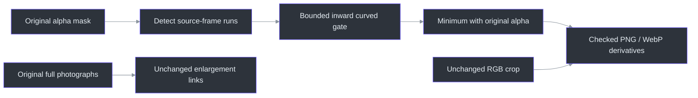
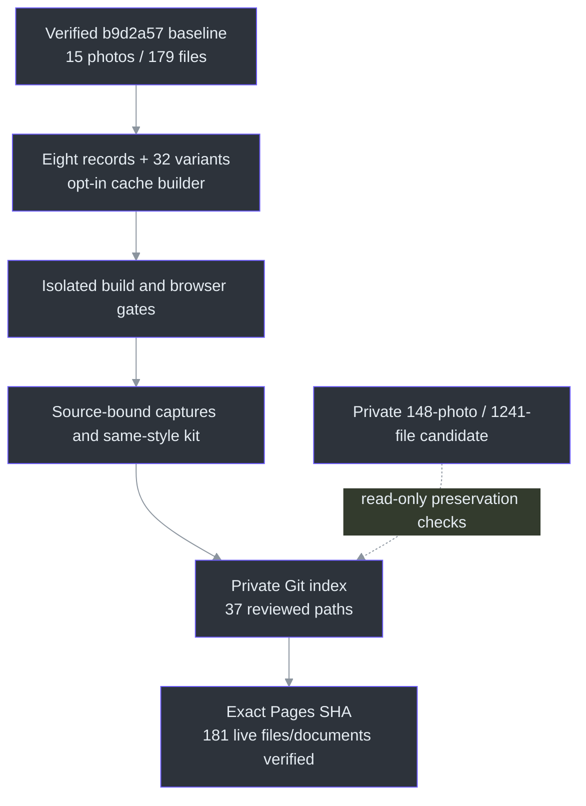

# Rounded sticker source-frame cuts

## Overview: round the crop, not the real object

The request concerns artificial straight cuts where an existing foreground mask
meets its original photograph frame, especially the Birthday example's right and
bottom. It does **not** authorize reshaping legitimate cake boards, signs or
toppers, expanding foreground, or reconstructing missing details. The implementation
detects sufficiently long solid-alpha runs only at the four source boundaries;
an interior rectangle remains unchanged. (`scripts/round_sticker_source_edges.py:27-35`,
`tests/test_sticker_source_edges.py:28-33`)

The parent's audit covered **148 active masks and one separate five-piece cover**.
Exactly eight masks needed the source-frame treatment: peacock-feather, cherry-topped,
pink-doll, purple-birthday, rose-topped, lavender-swirl, assorted-moulded-chocolates
and pastel-celebration. The other **140 records** and five-piece Chocolate cover
remain exact. This is recorded and independently checked in
`.local\rounded-active-stickers-20261010\authoring-validation.json` and
`release-provenance.json`. (`.local/rounded-active-stickers-20261010/release-provenance.py:29-88`)

## Architecture

The gate uses a curved profile with bounded depth and a small inset. Combining it
with `minimum(original, rounded)` prevents newly visible source foreground.
Pixels beyond each affected boundary band are explicitly protected. The algorithm
rejects empty masks, excessive removal, remaining long frame cuts, and long
replacement plateaus. It does not run a global organic-contour detector.
(`scripts/round_sticker_source_edges.py:57-115`)

## Components and contracts

| Component | Contract | Source |
|---|---|---|
| `source_edge_runs` | Examine source-frame alpha, not interior straight geometry | `scripts/round_sticker_source_edges.py:27-35` |
| `round_source_edges` | Inward-only alpha; protected interiors; bounded curved caps | `scripts/round_sticker_source_edges.py:57-115` |
| `prepare` / `install` | Verify source hashes, preserve previous bytes, install only explicit records | `scripts/round_sticker_source_edges.py:118-175`, `:181-234` |
| `validateStickerRevision` | Optional, validated revision metadata | `scripts/build-site.mjs:54-60` |
| `pictureMarkup` | Version both PNG/WebP URLs with each variant's exact SHA prefix | `scripts/build-site.mjs:150-174` |
| Cover-only regression | Keep the five-piece cover separate from the original assortment and photo link | `tests/cover-stickers.test.mjs:22-41` |
| Cache regression | Exact-byte URLs change without changing original JPG destinations | `tests/site.test.mjs:729-748` |
| Release provenance | Recompute alpha, verify original crops/photos, compare handoff bytes | `.local/rounded-active-stickers-20261010/release-provenance.py:25-94` |

## Data flow and cache behaviour

Only the eight affected photo-sticker records carry
`revision: "rounded-source-edges-20261010"`. The flag opts those derivatives into
`?v=<variant.sha256 first 12 characters>`; the revision label itself is not the
cache key. Unrevised stickers, the separate five-piece cover, and full-photo JPG
links keep their existing URLs. This is necessary because all **32 derivative
filenames remain unchanged**. (`scripts/build-site.mjs:54-60`, `:164-174`;
`tests/site.test.mjs:729-748`)

Inward trimming changes the prepared bounding boxes slightly. The generated
`width`/`height` attributes therefore follow the actual rebuilt variant dimensions,
not stale values. Native maximum widths such as 550, 722, 761, 844 and 874 are
retained rather than being forced to 1000. The release guard allows only the
specific hash-query and dimension substitutions derived from the final manifest.
(`.local/rounded-active-stickers-20261010/prepared-v2/manifest.json`;
`.local/rounded-active-stickers-20261010/release-helper.py`, `expected_revision_html`)

The original RGB/crop **source bytes** remain unchanged. Rebuilt, resized PNG/WebP
derivatives naturally have different bytes; this is not a claim of per-pixel
identity between old and new derivative rasters.
(`scripts/round_sticker_source_edges.py:138-165`)

## Verification

The parent supplied `prepared-v2`; the earlier `prepared-v1` failed a flat-run
criterion and remains private history. The release workflow did not modify the
rounding algorithm, masks or prepared outputs.
(`.local/rounded-active-stickers-20261010/release-integrate.py`, `main`;
`.local/rounded-active-stickers-20261010/release-provenance.py:42-66`)

- All eight revised masks are byte-equivalent to a fresh, read-only computation
  from the backed-up masks. No alpha exceeds its previous value.
- Retained source-mask alpha is **94.77–99.54%**. The Birthday source-mask region
  of the upper 600 rows and first 1000 columns, including its topper, stays exact.
- The Birthday right/bottom raster plateaus reduce from **462→68** and **630→90**
  pixels; the Doll base changes **727→105**. These are quantized-curve metrics,
  not a claim that legitimate straight details disappeared.
- All **592 authoring full-photo variants** retain their hashes. All **60 public
  original-photo variants** match the previous public Git blobs.
- Five parent Python tests pass. The 68 selected Node checks comprise 57 genuine
  frozen-public site/cover checks and 11 current-authoring cover checks: 67 passed
  initially, and the sole missing-package-fixture case passed its targeted rerun.
- All four browser gates pass locally and publicly: sticker loading/provenance,
  full notebook fit, full site, and entrance. Each environment checks **134 notebook
  states and 300 enlarged-photo states**. The dedicated sticker gate verifies all
  **32 actual cache-query responses** and 16 desktop/touch-emulated interactions
  across the eight examples, including original-JPG destinations and focus return.
- No-JavaScript and reduced-motion output expose the complete fifteen-photo
  catalogue. No physical-device or new owner visual acceptance is claimed.

Evidence: `release-provenance.json`, `release-alpha-tests.log`,
`release-node-tests-v1.log`, `release-node-fixture-rerun.log`,
`release-local-gates-v2\gates.json`, and `release-public-gates-v1\gates.json`.
The mask/property assertions are in `tests/test_sticker_source_edges.py:13-63`;
live-image assertions are in
`.local/rounded-active-stickers-20261010/release-review-stickers.py:37-126`.

Retained failed checks concern the private harness: the old frozen source had no
mask directory, JSON arrays needed normalization when comparing Python tuples,
a test fixture lacked the real `package.json`, and width-descriptor `srcset`
produces density-corrected `naturalWidth`/`naturalHeight`. Raw response dimensions
remain strictly verified; the browser check additionally verifies declared
dimensions and the selected image's aspect ratio.
(`.local/rounded-active-stickers-20261010/release-review-stickers.py:43-48`, `:72-83`)

## Isolated publication

The new builder first reproduces all **179** previous public files with the
legacy manifest. Only then are the eight final records, 32 derivatives and eight
private mask copies overlaid into the frozen fifteen-photo source. The complete
148-record manifest is never copied into the release.
(`.local/rounded-active-stickers-20261010/release-integrate.py`, `main`;
`release-no-revision-proof.json`)

The capture adapter requires the exact `--source-dir`, compares the served HTML
with that directory, and hashes the complete site before/after capture. It uses
26-second cloth-rest waits. Its input-image hashes remain bound even after the
new showcase outputs are installed.
(`.local/rounded-active-stickers-20261010/release-capture.py:24-49`;
`.local/rounded-active-stickers-20261010/release-publisher.py`, `check`)

Current kit: `exports\website-launch-20261010-rounded-sticker-edges\preview.html`.
It contains six wide and six 3:4 portraits. Only 04/05 in both formats change;
the other eight exports remain byte-identical. All four existing treatment flags
remain: frosted cream, portrait colour variance, raised phone glass on portraits
01/06 only, and no diagonal light bands. **51 campaign tests, 72 actual-JPEG raster
checks**, and responsive offline-kit checks pass. Nothing was posted to Instagram.
(`release-art-differences.json`, `release-kit-review.json`,
`exports/website-launch-20261010-rounded-sticker-edges/manifest.json`)

### Final receipt

- Commit: `5a21f7d7cbbb4e84f744674077f896dc5f8f00a6`.
- Pages: [37991143358](https://github.com/Zanark/WhiskAndCrumbs/actions/runs/37991143358).
- Site: <https://zanark.github.io/WhiskAndCrumbs/>.
- Public scope: **179 files / 15 photos**, runtime version **`32df5a36a07f` unchanged**.
- Exact changed paths: 32 stickers, generated HTML, showcases 04/05, README and ABOUT.
- All 179 live site files and both root documents match Git; all 32 actual revised
  query URLs pass. Original full photos and the five-piece Chocolate cover stay exact.
- The private-index transaction compared **3309 existing worktree files** with no
  concurrent metadata differences. All **2720 protected files**, including the
  entire **1241-file / 148-photo private candidate**, remain unchanged.
- No root-site build, root staging, archive publication, image-tool viewing,
  original-RGB editing, production-cream changes or social posting occurred.
- Final private receipt:
  `.local\rounded-active-stickers-20261010\publication.json`.

The owner requested artificial-cut rounding. That authorization is not a fabricated
approval of the resulting masks or a physical visual review.
