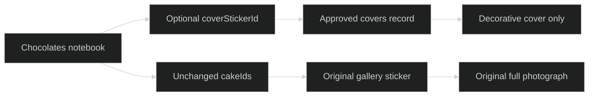
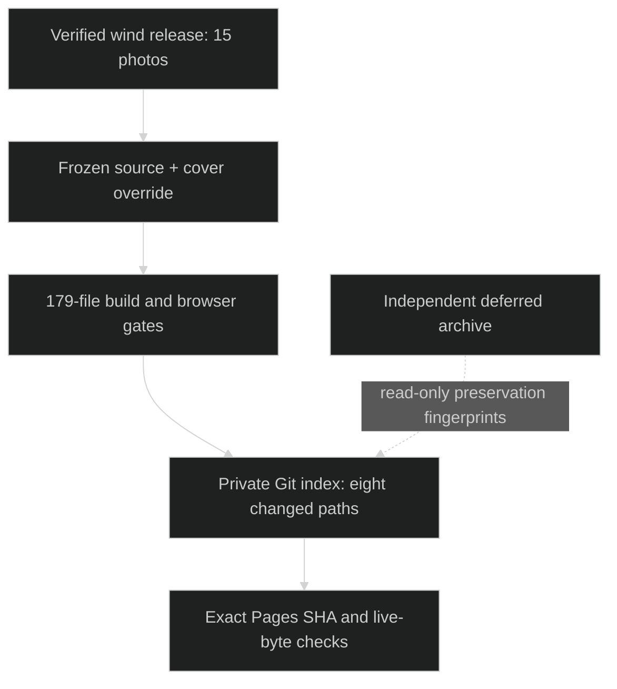

# Five-piece Chocolate cover

The owner approved the ten extracted edges and delegated a random selection of
five, arranged unevenly rather than in a circle. The one-time selection is fixed:
**flower-detailed, flower-right, heart-left, heart-right and spiral-left**.
The approved native cutouts were not changed or selected again.

The public release remains **15 photo records / 179 files**. Chocolate still has
one photo record. Its notebook and enlargement retain the original full assortment
and all eight existing photograph/sticker variants.

## Decorative-only contract

`content/notebooks.json` adds `coverStickerId` only to Chocolates. Its existing
`coverCakeId` and `cakeIds` remain unchanged. A separate `covers` collection in
the private sticker manifest records the approved source, five piece hashes,
approval/recipe hashes and four prepared PNG/WebP variants.

The builder validates every supplied cover record, including unused records:
unique safe IDs, known source and matching provenance, approval, unchanged unique
pieces, and paired 480/1000 variants. A notebook reference must match its existing
cover cake. Only a decorative, non-hero picture may use an override.
Gallery and enlargement code continue to use the ordinary cake/photo mapping.
Only referenced cover variants enter the public copy list, after byte/hash checks.

Sources: [validation](../scripts/build-site.mjs#L99-L139),
[picture isolation](../scripts/build-site.mjs#L141-L170),
[notebook binding](../scripts/build-site.mjs#L188-L193),
[cover rendering](../scripts/build-site.mjs#L272-L279), and
[checked copying](../scripts/build-site.mjs#L448-L457).

## Evidence and limits

- The old 15-photo build reproduces all 175 wind-release files with the new builder
  and no override. Text comparison normalizes CRLF only; binary comparisons are exact.
- Four approved derivatives were copied unchanged. Each has five disconnected
  substantial silhouettes. Four hull vertices and radial-distance variation
  approximately `.398` document the uneven arrangement, not aesthetic acceptance.
- All ten approved native piece files and eight original assortment variants
  retain their recorded hashes.
- **56** current-authoring Node tests pass; the same **11** cover regressions also
  pass against the genuine frozen 15-photo source. Tests include unreferenced
  assets, malformed provenance, colliding filenames, gallery isolation and
  rejecting altered bytes before writing output.
- Local cover, full-site, entrance and notebook-fit reviews pass. Public cover,
  full-site and entrance reviews pass. Keyboard activation, focus return,
  original-photo enlargement, no-JavaScript output and responsive bounds are checked.
- No image-tool views, mask refinements, source uploads or Instagram posting
  occurred. Browser/touch-emulation and numerical checks are not native-phone
  testing or a new owner visual-acceptance claim.

## Refreshed launch kit

Current delivery: `exports\website-launch-20261009-five-selected-chocolates\`.
Its offline `preview.html`, six wide images, six 3:4 portraits, caption, alt text
and six-image Instagram ZIP are complete.

The fresh captures retain 26-second cloth-rest waits and are explicitly bound to
the isolated public candidate, not the unrelated main `site\`.
The existing composition keeps frosted Gaussian cream, varied portrait ground
colours, raised phone glass on portraits 01/06 only, and no diagonal light bands.
All **51** campaign tests and **72** actual-JPEG raster readability checks pass.
The offline kit loads all twelve images without horizontal overflow at 360/1280px.

Portrait 04 changes because it contains the complete six-cover feature.
Wide 04 is byte-identical: both of its actual full viewports exclude Chocolates.
The new cover also appears behind the open notebook in the genuine 05 captures,
so wide/portrait 05 change. The other nine exports are byte-identical.
Only the changed wide 05 is updated publicly; the README retains six linked images
and content-hash keys. See `capture-difference-proof.json` and
`showcase-installation.json` in the private evidence folder.

## Isolated publication and concurrent archive work

The release source is copied from the verified wind snapshot, not the main
authoring candidate. A separate index commits only the generated cover HTML,
four approved assets, the genuinely changed showcase 05, and README/ABOUT.
No root build, checkout, reset, cleanup or staging of the main candidate is used.

During final checks, another session expanded the deferred candidate from
**60 photos / 533 files** to **148 photos / 1241 files** and updated its taxonomy
tests. The first safety check stopped; its failure and both boundaries are retained.
This workflow did not perform that import or rewrite the main site.
All original 60 sticker records remain exact, and 530 of the original 533 main
files remained unchanged; the other session rebuilt its HTML, wind module and
showcase 05 from current authoring inputs.

After recording the stable new private boundary, the scoped transaction preserved
**3289 existing worktree files** and a clean index. A separate post-commit proof
verified all **2720** protected source/candidate files, including the entire
1241-file main site. The public tree remains 15 photos; none of the additional
archive products or assets was published.

## Release receipt

- Commit: `b9d2a571ed54f4342d4a568d7cfd1f334818c03c`.
- Pages: [37980997473](https://github.com/Zanark/WhiskAndCrumbs/actions/runs/37980997473).
- Runtime/cache version: `32df5a36a07f`, unchanged from wind68.
- All **179** live site files and both root documents match their Git blobs.
- Canonical: <https://zanark.github.io/WhiskAndCrumbs/>.
- Private receipt: `.local\chocolate-cover-selection-20261009\publication.json`.
- Earlier wind68 receipt remains separate:
  `.local\awning-scroll-wind-20261009\publication.json`.

The retained failed checks are evidence, not superseded source revisions:
`node-tests-v1.log` covers new fixture wiring, `node-tests-v3.log` records the
other session's in-flight taxonomy changes, `precommit-check-v1.log` records the
concurrency stop, and `kit-review-attempt-1.json` records a private reviewer
attempting to decode images in the initially closed README disclosure. The final
kit review opens that native disclosure and uses bounded image-loading checks.
