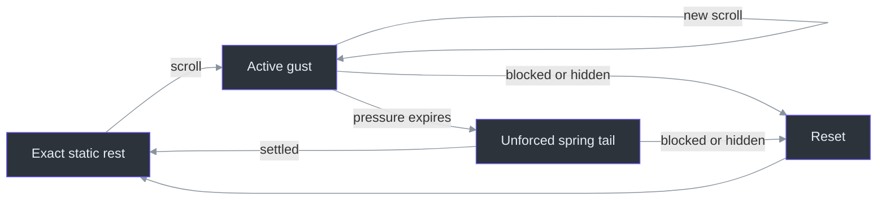

# Strong, long-lived awning scroll wind

Status: deployed and locally/publicly verified; completed2026-10-10.
Commit: `feb6169550f5759275ad33b428dae763cebafe2e`.
[Pages37971393377](https://github.com/Zanark/WhiskAndCrumbs/actions/runs/37971393377)
succeeded for this exact SHA. Version: `32df5a36a07f`.
All175live site files plus README/ABOUT match committed bytes.

## Overview

The owner requested a much stronger response to scrolling that continues like wind
after scrolling stops. Scroll input now combines an immediate kick with eighteen
seconds of travelling pressure; the final unforced spring motion then settles to
exact rest. Pointer-only input keeps its previous behavior.
Sources: `web\awning-cloth.mjs:112-194`; comparison evidence:
`.local\awning-scroll-wind-20261009\model-comparison.json`.

## Architecture

The unchanged controller measures scroll displacement, checks visibility and
accessibility/overlay gates, and calls `impulseScroll`. Its existing renderer
projects the bounded model through the same texture, shading and fixed-rail
overlays. Sources: `web\awning.mjs:183-201`, `web\awning.mjs:297-311`,
`web\awning.mjs:122-143`.

## Components and implementation

| Mechanism | Invariant |
| --- | --- |
| `impulseScroll` | Signed, capped input renews the pressure envelope and gives an immediate velocity kick. |
| `integrate` | Two travelling spatial waves use exponential decay and a smooth final four-second fade. |
| `reset` | Clears displacement, velocity, pointer state, wind strength, age and phase. |
| Existing renderer | Model cap `min(26px, 14% of height)` projects to at most19.5px vertically, within its unchanged20px gutter. |

Sources: `web\awning-cloth.mjs:41-49`, `web\awning-cloth.mjs:112-158`,
`web\awning-cloth.mjs:208-217`; `web\awning.mjs:1`,
`web\awning.mjs:122-135`. The existing backing-store budget remains approximately
two million pixels (`web\awning.mjs:65-68`).

The model cannot settle while wind is active. Once all settling criteria pass,
arrays return to exact zero and the renderer stops scheduling frames. Preference,
visibility, dialog, blur and page-lifecycle interruptions retain the existing reset
path. Sources: `web\awning-cloth.mjs:182-193`; `web\awning.mjs:191-201`,
`web\awning.mjs:241-256`, `web\awning.mjs:317-341`.

## Validation and release boundary

- Parent model evidence:19targeted tests, nine old/new scroll comparisons and
  4,320byte-identical pointer-only frames. Scroll duration, reversal, extremes,
  fixed anchors and reset are covered in `tests\awning-cloth.test.mjs:225-296`,
  `tests\awning-cloth.test.mjs:365-442`.
- The response reviewer measures actual uploaded GPU vertex buffers, including
  desktop down/up and touch scroll, late5/10/14-second motion, pinned offsets and
  zero post-idle uploads (`scripts\review_cloth_response.py:10-66`, `:106-125`).
- The fabric reviewer retains pixel locality, native exact-rest artwork, rendering
  budget, preference/overlay stops, context recovery, resizing, touch and complete
  static fallbacks (`scripts\review_awning_fabric.py:119-155`, `:182-316`).

Allfive sequential local gates passed without reviewer changes. The measured
desktop60pxdown/up gusts reached19.5pxprojected displacement across approximately
1410pxof the1440pxwidth, retained5.26pxat14seconds and reached exact idle around
19.41seconds. Touch390pxpeaked at15.75px, retained3.61pxat14seconds and stopped at
19.10seconds. Pinned offsets and post-idle uploads were zero. The pointer-only
release still stopped around4.71seconds.
Evidence: `local-gates-v1\response\review.json` under the evidence root.

The four sequential public response/fabric/site/entrance gates also passed.
Public desktop down/up traces reached the same19.5pxpeak and5.26px14-second tail,
with exact idle at19.48/19.41seconds. Simulated touch retained3.61pxat14seconds and
stopped at19.11seconds. Public pointer-only release was4.75seconds; all pins and
post-idle upload counts remained zero.
Evidence: `public-gates-v1\response\review.json` and `public-gates-v1\gates.json`.

The isolated builder first reproduced all175files of
`68d2aece95ffd26ed15f89be74d1baa16607b409` after text line-ending normalization;
binary media are exact. The reviewed fifteen-cake dataset is separate from the
unpublished sixty-cake/533-file root candidate. Current reviewers use an exact
private copy with genuine fifteen-cake fixtures, not reduced expectations.

Only `site\awning-cloth.mjs`, generated cache-version `site\index.html`, and the
owner's exact ABOUT scroll-description replacement are authorized. Renderer,
styles, original SVGs,120product variants, six showcase images and README are
unchanged. No launch-art recapture, image-tool views, Instagram posting, local cream
integration, or owner visual acceptance is implied.

## References

Evidence root: `.local\awning-scroll-wind-20261009\`.

- `baseline-proof.json`, `review-fixture-proof.json`: reconstruction and fixtures.
- `model-tests-final.log`, `model-comparison.json`: parent model evidence.
- `local-gates-v1\`: sequential response/fabric/supports/site/entrance checks.
- `candidate-proof.json`, `release-procedure.txt`: exact payload and safe index-only commit.
- `commit-receipt.json`, `postcommit-proof.json`: exact three-path commit, required
  co-author/session trailers, clean index and1766byte-preserved inventoried
  nonignored worktree files.
- `pages-final.json`, `live-byte-proof.json`,
  `canonical-live-entrypoint-proof.json`: exact successful deployment,177public
  file comparisons, and ordinary canonical HTML/versioned-module checks.
- `public-gates-v1\`: passed response/fabric/site/entrance reports, without changing
  any reviewer thresholds or substituting expected catalogue counts.
- `publication.json`, `publication-preservation.json`: final release and unchanged
  533-file/60-cake import candidate, including358untracked archive variants.
- `precommit-attempt-1.json` retains the initial safety stop on concurrent
  parent-owned chocolate/context metadata. No public/index mutation occurred
  during that attempt; the exact public three-path boundary was not expanded.
- `finalization-attempt-1.json` records unrelated concurrent changes to
  `scripts\refine_archive_sticker_contours.py` and the added
  `tests\test_rounded_archive_stickers.py`. They were preserved, not edited,
  reverted or included in this publication. All1650release-protected files,
  including the complete533-file main candidate, remained byte-identical.

No wind implementation, review or publication task remains. The browser lane is
released. Global index, ledger, AGENTS and context updates remain parent-owned.
